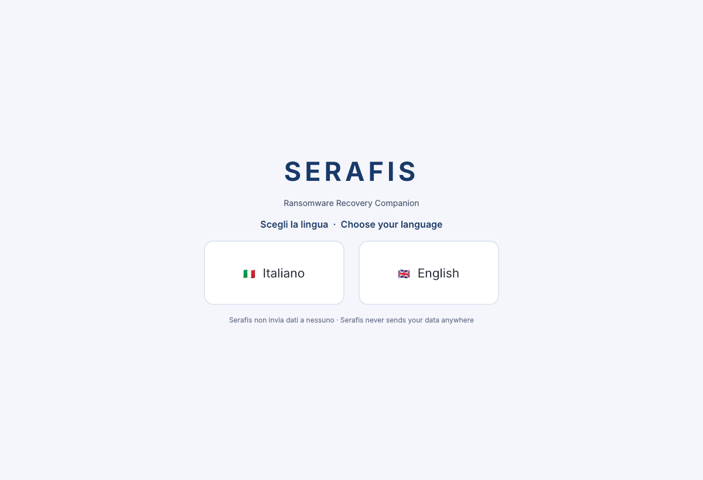
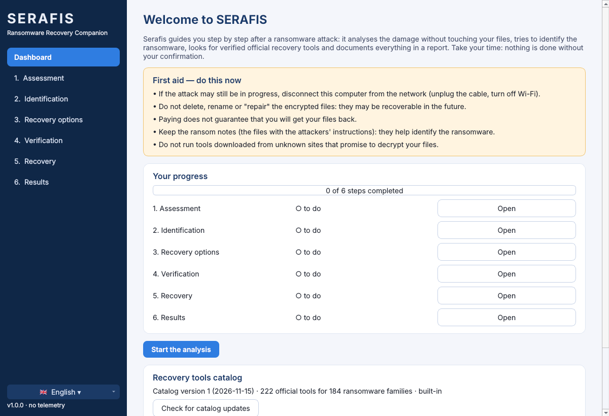
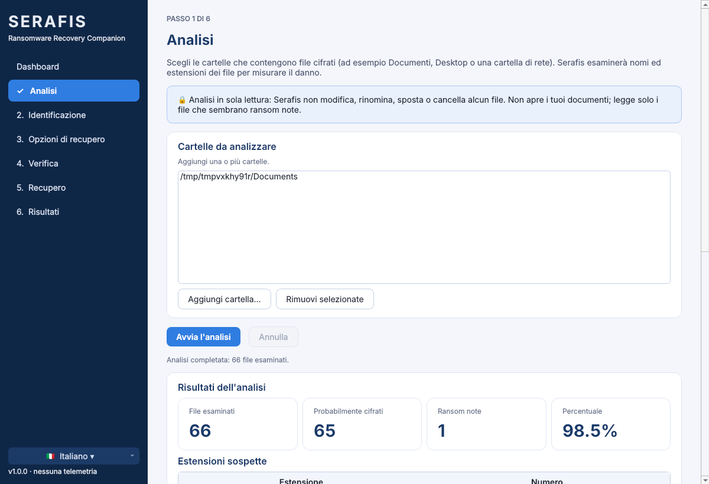
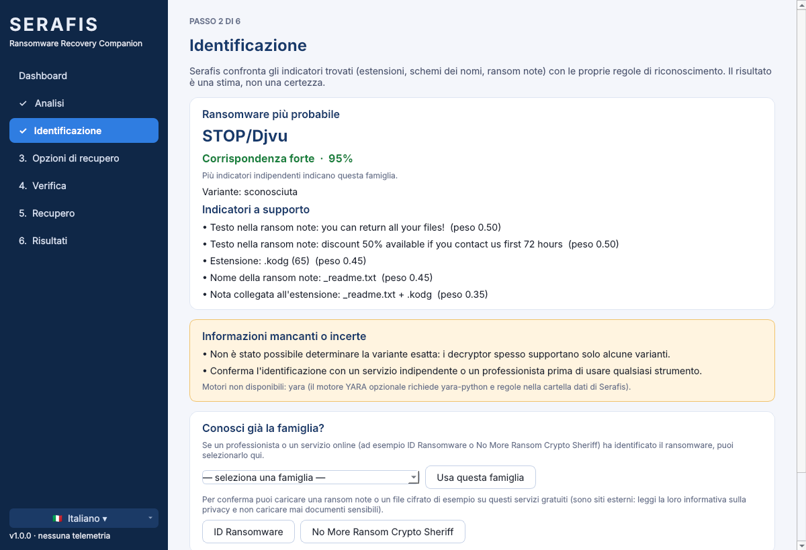
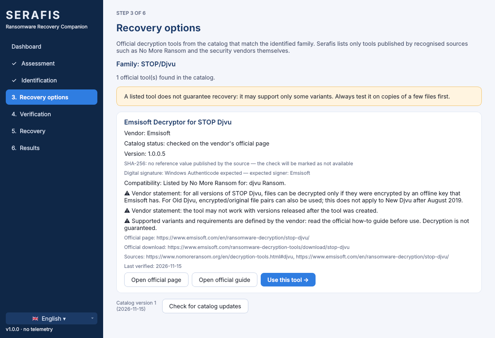
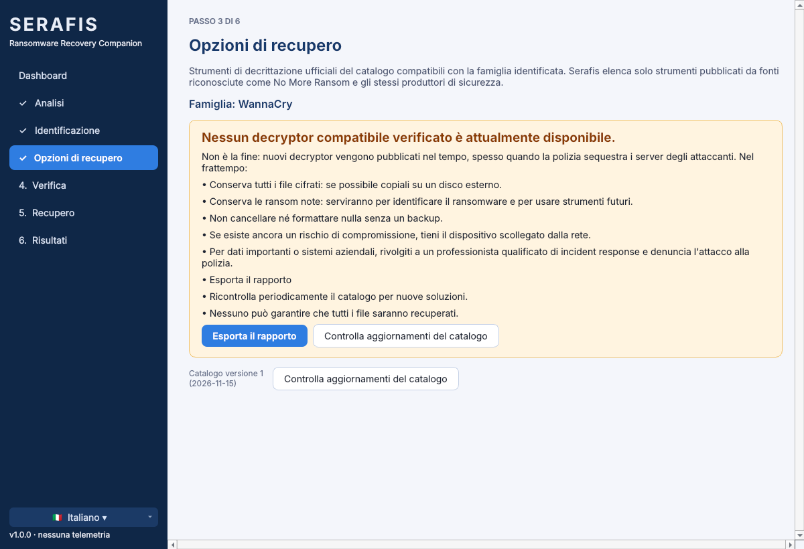

<p align="center"></p>

<h1 align="center">SERAFIS</h1>
<p align="center"><b>Ransomware Recovery Companion</b></p>

<p align="center">
  <a href="https://github.com/Pla1maker/Serafis/releases/latest/download/Serafis.exe"><b>⬇️ Download Serafis for Windows</b></a>
  &nbsp;·&nbsp;
  <a href="https://github.com/Pla1maker/Serafis/releases/latest">Latest release / Ultima release</a>
  &nbsp;·&nbsp;
  <a href="docs/QUICKSTART.md">Quick start</a>
</p>

---

## 🇮🇹 Italiano

**Serafis** è un'applicazione desktop per Windows, gratuita, open source ed **esclusivamente difensiva**, che guida
passo dopo passo una persona colpita da ransomware: analizza i danni **senza toccare i file**, prova a identificare il
ransomware in modo prudente, cerca **strumenti di decrittazione ufficiali** in un catalogo verificato, li controlla prima
dell'uso e documenta tutto in un rapporto esportabile. È pensata per chi non ha conoscenze informatiche.

### Funzionalità
| Passo | Cosa fa |
|---|---|
| **1. Analisi** | Selezione di una o più cartelle; analisi in **sola lettura** di nomi ed estensioni; individuazione delle ransom note; numero e distribuzione dei file probabilmente cifrati; limiti di file/tempo e annullamento. I documenti personali non vengono mai aperti. |
| **2. Identificazione** | Regole JSON aggiornabili (30 famiglie): estensioni, schemi dei nomi, nomi e testo delle ransom note, collegamento nota↔estensione. Mostra famiglia, variante, indicatori, livello di confidenza (forte / probabile / possibile), alternative e informazioni mancanti. Architettura a motori estendibile (motore YARA opzionale). |
| **3. Opzioni di recupero** | Catalogo firmato di **222 strumenti ufficiali per 184 famiglie**, generato dalla pagina ufficiale di **No More Ransom**: fornitore, URL ufficiale, versione, SHA-256, firma, compatibilità, limiti, data di verifica, fonti. Aggiornamento online sicuro (firma Ed25519, schema, anti-downgrade). |
| **4. Verifica** | Provenienza ufficiale (anche tramite il marcatore di download di Windows), SHA-256 rispetto a un valore attendibile, firma digitale Authenticode, compatibilità dichiarata. I controlli non disponibili sono mostrati chiaramente. Nessun download o esecuzione automatica. |
| **5. Recupero** | Guida al backup, cartella di lavoro con **copie** verificate bit per bit, test su pochi file solo dopo conferma esplicita, istruzioni per lo strumento ufficiale, controllo dei risultati, recupero completo sbloccato solo dopo una prova riuscita. |
| **6. Risultati** | Rapporto con data, cartelle, indicatori, ransomware ipotizzato, confidenza, soluzioni, fonti, verifiche, prove, problemi e raccomandazioni. Esportazione **JSON, HTML e PDF**, senza dati personali non necessari. |

Se non esiste un decryptor verificato e compatibile, Serafis lo dice chiaramente — *«Nessun decryptor compatibile
verificato è attualmente disponibile.»* — e spiega come conservare i dati, isolare il dispositivo, rivolgersi a
professionisti e ricontrollare il catalogo nel tempo. **Serafis non promette mai che tutti i file saranno recuperati.**

### Download e installazione
1. Scarica **[Serafis.exe](https://github.com/Pla1maker/Serafis/releases/latest/download/Serafis.exe)** dall'[ultima release](https://github.com/Pla1maker/Serafis/releases/latest).
2. (Consigliato) verifica l'hash: `Get-FileHash .\Serafis.exe -Algorithm SHA256` e confrontalo con `Serafis.exe.sha256` della release.
3. Avvia `Serafis.exe`: non serve installare Python né altro. Requisiti: Windows 10/11 a 64 bit.

L'eseguibile non è firmato con un certificato di code signing: Windows SmartScreen può mostrare un avviso.

---

## 🇬🇧 English

**Serafis** is a free, open-source and **strictly defensive** Windows desktop app that guides ransomware victims step
by step: it assesses the damage **without touching any file**, cautiously identifies the ransomware family, finds
**official decryptors** in a verified catalog, verifies them before use and documents everything in an exportable report.

### Features
- **Assessment** — read-only scan of file names/extensions in one or more folders, ransom-note detection, count and distribution of likely-encrypted files.
- **Identification** — maintainable JSON rules (30 families), confidence levels, supporting indicators, alternatives, missing information; pluggable engines (optional YARA).
- **Recovery options** — signed catalog of 222 official tools for 184 families built from the official No More Ransom page; secure online updates (Ed25519 signature, schema validation, anti-downgrade, HTTPS allow-list).
- **Verification** — official origin, SHA-256 vs trusted value, Authenticode signature, declared compatibility; unavailable checks are shown explicitly.
- **Recovery** — backup guidance, copy-only work folder, explicit confirmations, test first, result checks, full recovery unlocked only after a successful test.
- **Results** — JSON / HTML / PDF report without unnecessary personal data.
- **No decryptor case** — clear message, data-preservation advice, periodic catalog re-check.
- Full **Italian 🇮🇹 / English 🇬🇧** UI, persistent language choice.

### Download
**[⬇️ Download Serafis for Windows](https://github.com/Pla1maker/Serafis/releases/latest/download/Serafis.exe)** — single executable, Windows 10/11 64-bit, no Python required. Verify it with the published `Serafis.exe.sha256`.

---

## Screenshots
| | |
|---|---|
|  |  |
|  |  |
|  |  |

## Usage / Utilizzo
1. Choose the language → **Dashboard** with first-aid advice and progress.
2. **Assessment**: add folders → *Start analysis* (confirmation) → results.
3. **Identification**: automatic; you can also select a family confirmed by a professional.
4. **Recovery options**: official tools for the family, or the no-decryptor guidance.
5. **Verification**: download from the official source (explicit confirmation) or select the downloaded file → *Verify*.
6. **Recovery**: backup → work folder → test files → official tool → check results.
7. **Results**: export JSON / HTML / PDF.

## Run from source / Esecuzione dai sorgenti
```bash
git clone https://github.com/Pla1maker/Serafis.git
cd Serafis
pip install -r requirements-dev.txt
python -m serafis              # start the GUI
python -m pytest               # run the test suite
pyinstaller Serafis.spec       # build dist/Serafis.exe (on Windows)
```

## Security / Sicurezza
Serafis contains **no** ransomware creation, malicious encryption, data exfiltration, persistence, antivirus tampering,
hidden execution, or automatic download/execution of unverified binaries. Ransom notes, file names, archives and
external content are treated as untrusted data. Input validation, path-traversal protection, timeouts, safe network
error handling, redacted local logs, explicit confirmations, **no telemetry**. Details: [SECURITY.md](SECURITY.md).

## Project structure
```
serafis/
  app/            entry point, headless self-test
  core/           models, safe paths, settings, logging
  analysis/       read-only scanner, indicator extraction
  identification/ rules loader, engines (rules, optional YARA)
  catalog/        catalog model/validation, signed updater, trust anchors
  verification/   SHA-256, origin, Authenticode, safe official download
  recovery/       copy-only workflow, result checks
  reporting/      JSON / HTML / PDF
  localization/   it.json, en.json
  gui/            PySide6 interface (pages, widgets, styles)
  data/           catalog.json (+ .sig, schema), rules/families.json
tests/            pytest suite (synthetic files only)
scripts/          catalog build/sign, icon, screenshots, version info
.github/workflows CI, Windows build, release
```

## Known limitations / Limiti noti
- Identification is heuristic and indicators can be spoofed: always confirm it (ID Ransomware, No More Ransom Crypto Sheriff, a professional).
- No More Ransom does not publish versions or SHA-256 values of the tools: for most entries the hash check is shown as *not available*; authenticity relies on the official origin and the Authenticode signature (checked on Windows).
- Expected signer names are a heuristic based on the vendor name; a mismatch is shown as a warning to check, not as proof of fraud.
- Serafis does not run decryptors silently or with arguments: tools are run by the user (Serafis can open a verified tool in its own visible window).
- The result check uses file headers; formats without a known header are marked "to check manually".
- The executable is not code-signed; PyInstaller executables are sometimes flagged by antivirus heuristics.
- The optional YARA engine requires `yara-python` and user-supplied rules (`%APPDATA%\Serafis\yara\*.yar`) and is not included in the executable.

## Contributing
See [CONTRIBUTING.md](CONTRIBUTING.md) and [docs/CATALOG.md](docs/CATALOG.md).

## License
[MIT](LICENSE). The Windows executable bundles Qt for Python (PySide6, LGPL-3.0).
